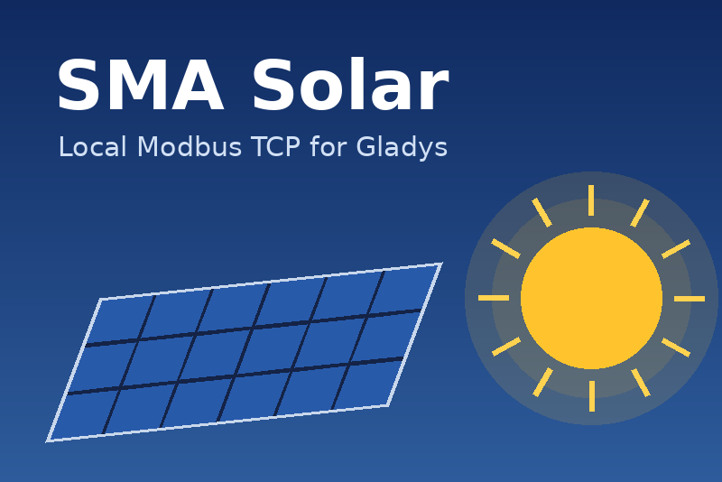

# SMA Solar for Gladys Assistant

[](https://github.com/gboulvin/Gladys-SMA-Solar/actions/workflows/ci.yml)



An external integration for [Gladys Assistant](https://gladysassistant.com)
that brings your **SMA** solar installation into Gladys: inverters (Sunny Boy,
Sunny Tripower, Sunny Highpower), hybrid inverters (Smart Energy) and battery
inverters (Sunny Boy Storage, Sunny Island), plus the grid exchange measured by
an SMA Energy Meter or Sunny Home Manager.

- **100 % local**: read over **Modbus TCP** on your network, no cloud, no
  Sunny Portal account, no API key.
- **Read-only**: the integration never writes to your inverters.
- **Energy dashboard ready**: production, daily production, production index,
  battery level and energy, grid import / export, AC voltage and current,
  inverter temperature.
- **Scenes**: triggers _Solar production started_, _Solar production stopped_
  (with the energy of the day) and _SMA device condition changed_; actions
  _Read an SMA device_ and _Read the solar installation_.
- **Dashboard widgets**: _Solar installation_ overview and _SMA device_.
- **English, French, German and Spanish.**
- Requires **Gladys 5.3.0** or later.

User documentation: [English](docs/en.md) · [Français](docs/fr.md) ·
[Deutsch](docs/de.md) · [Español](docs/es.md).

## Quick start

1. Enable **Modbus TCP** on each SMA device (installer access) and give it a
   fixed IP address.
2. Install **SMA Solar** from the integration catalog of Gladys.
3. In its **Configuration** tab, enter the IP address of each device
   (`192.168.1.50, 192.168.1.51`; `host:port/unit_id` for devices behind a
   Data Manager), save, then click **Test the connection**.
4. Add the devices from the **Discovery** tab.

## How it works

| Register | Value                                   | Format   |
| -------- | --------------------------------------- | -------- |
| 30057    | serial number (device identity)         | U32      |
| 30051    | device class (PV, battery inverter...)  | U32      |
| 30201    | condition (OK, warning, fault, off)     | U32      |
| 30775    | AC power                                | S32, W   |
| 30517    | energy of the day (30535 on older ones) | U64, Wh  |
| 30513    | total energy (30529 on older ones)      | U64, Wh  |
| 30845    | battery state of charge                 | U32, %   |
| 31393/5  | battery charge / discharge power        | U32, W   |
| 30865/7  | grid import / export power              | S32, W   |
| 30581/3  | grid import / export meter              | U32, Wh  |
| 30783    | AC voltage, phase L1                    | U32 FIX2 |
| 30795    | AC current                              | U32 FIX3 |
| 30953    | internal temperature                    | S32 FIX1 |

Every `poll_frequency` seconds (30 by default), each device is read in one
short Modbus session. Only the values that changed are sent to Gladys (plus a
15-minute heartbeat). A device that sleeps at night shows as unreachable with
0 W of production, and the identified devices are remembered in
`/data/sma-devices.json` so they stay available after a restart.

## Development

```bash
npm install
npm test             # unit tests, against a simulated SMA device
npm run lint
npm run format:check
```

Run it against a real Gladys:

```bash
GLADYS_HOST_API_URL="http://localhost:1443" \
GLADYS_INTEGRATION_TOKEN="<token>" \
GLADYS_INTEGRATION_SELECTOR="sma-solar" \
SMA_DATA_DIR=./data \
LOG_LEVEL=debug \
npm start
```

See [CLAUDE.md](CLAUDE.md) for the architecture and the project rules.

## Release

Describe the changes under `## [Unreleased]` in [CHANGELOG.md](CHANGELOG.md),
then **Actions → Release → Run workflow** (`patch`, `minor` or `major`): the
workflow bumps the version everywhere, tags it, builds the `linux/amd64` +
`linux/arm64` image to `ghcr.io/gboulvin/gladys-sma-solar` and publishes the
GitHub Release.

## Security

See [SECURITY.md](SECURITY.md). Modbus TCP has no authentication: never expose
port 502 of your devices to the Internet.

## License

[Apache-2.0](LICENSE). SMA, Sunny Boy, Sunny Tripower, Sunny Island and Sunny
Portal are trademarks of SMA Solar Technology AG; this project is not
affiliated with SMA.
